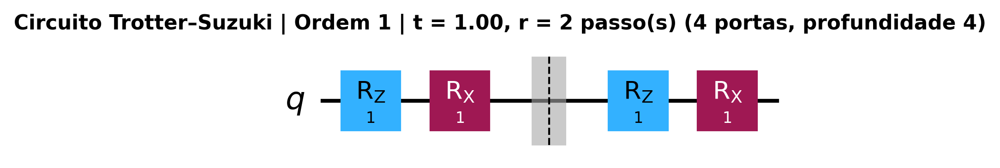
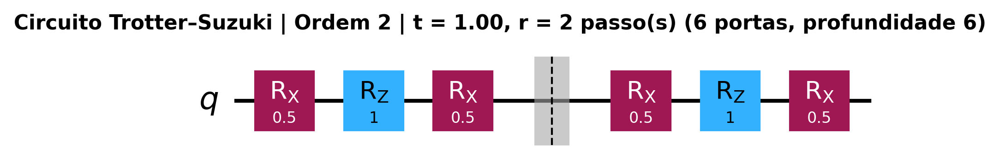
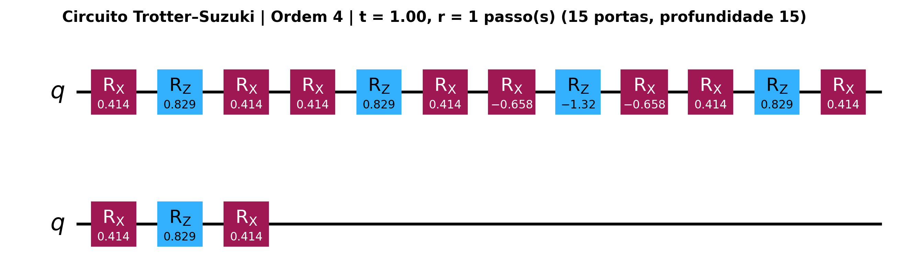
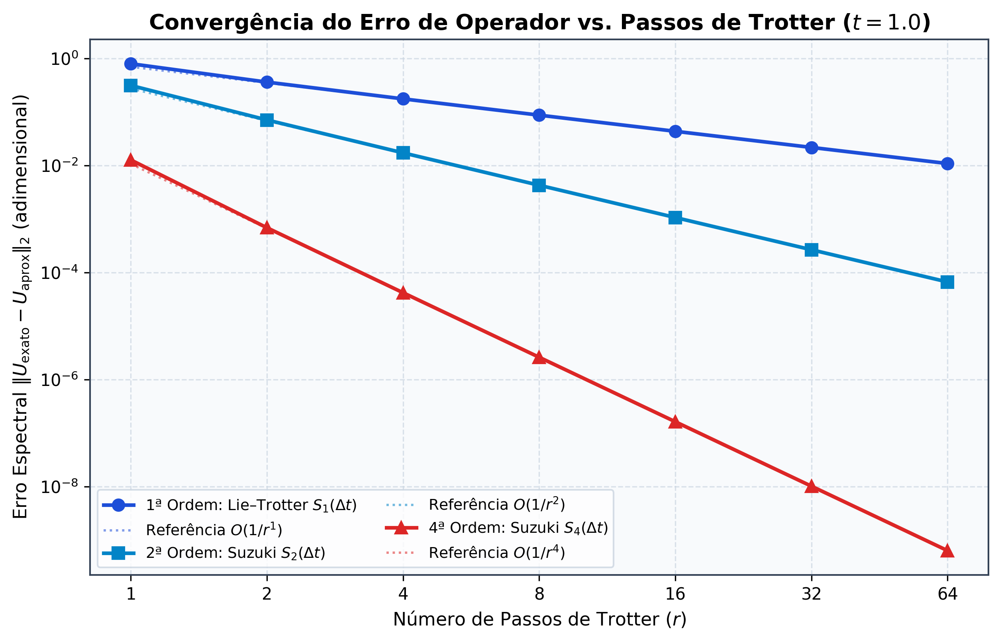
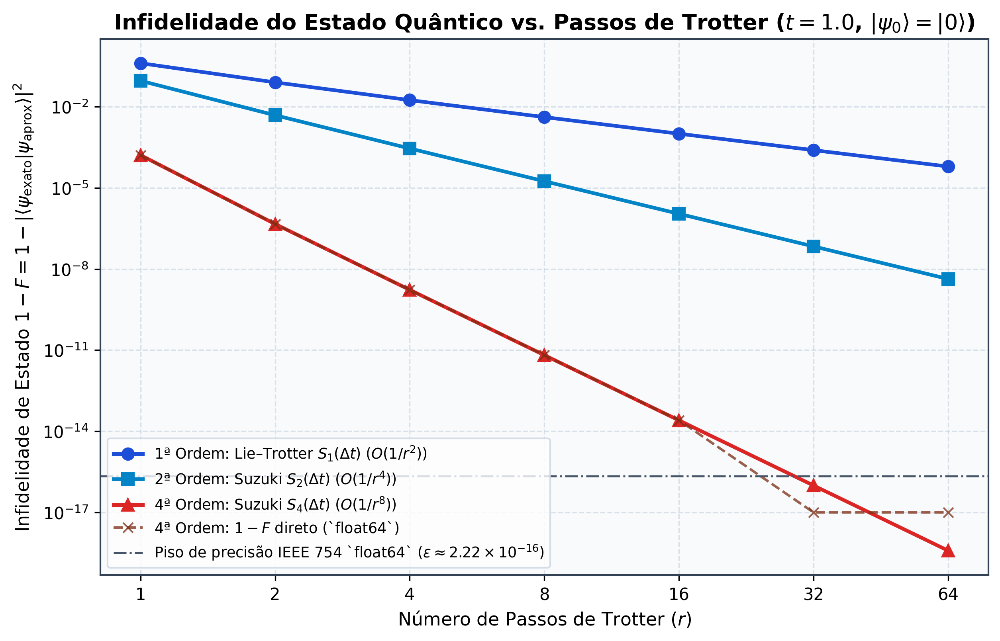
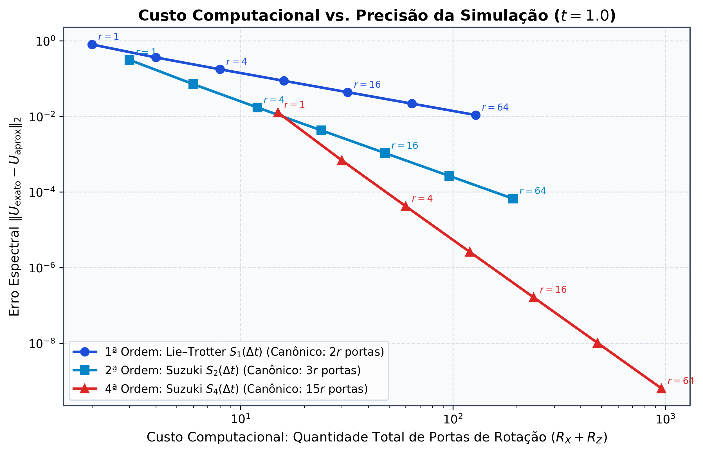
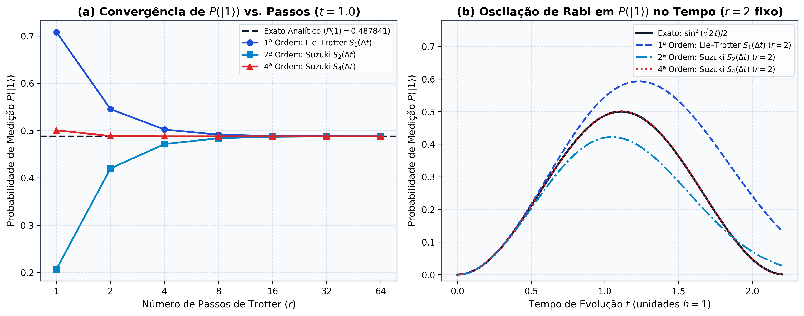
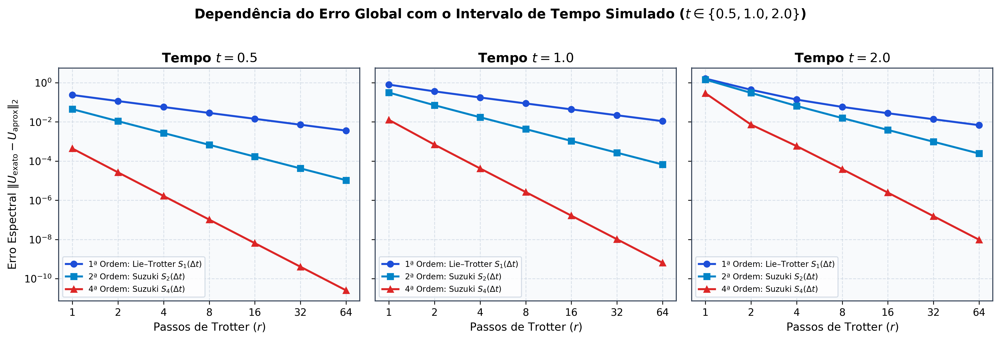

# Simulação Quântica da Evolução Temporal via Método de Trotter–Suzuki

[](https://www.python.org/)
[](https://qiskit.org/)
[](#testes-e-validação)
[](LICENSE)

Implementação científica, reprodutível e documentada das **fórmulas de produto de Lie–Trotter e Suzuki (1ª, 2ª e 4ª ordens)** aplicadas à **simulação Hamiltoniana quântica** em circuitos do **Qiskit**.

> **Nota sobre o Escopo Computacional:** Este projeto utiliza **simulação clássica exata de circuitos quânticos** (álgebra linear de precisão dupla e `qiskit.quantum_info`) em um sistema de 1 qubit para isolar e demonstrar rigorosamente o erro matemático das decomposições de Trotter–Suzuki. **O projeto não executa em hardware quântico físico e não reivindica demonstração de vantagem quântica sobre computadores clássicos.**

---

## Sumário

1. [Motivação da Simulação Hamiltoniana e o Problema de Trotter–Suzuki](#1-motivação-da-simulação-hamiltoniana-e-o-problema-de-trottersuzuki)
2. [Formulação Matemática do Problema ($H = X + Z$)](#2-formulação-matemática-do-problema-h--x--z)
3. [Métodos Implementados: 1ª, 2ª e 4ª Ordens](#3-métodos-implementados-1ª-2ª-e-4ª-ordens)
4. [Tradução para Circuitos Quânticos no Qiskit](#4-tradução-para-circuitos-quânticos-no-qiskit)
5. [Experimentos Realizados e Resultados Numéricos](#5-experimentos-realizados-e-resultados-numéricos)
6. [Gráficos Científicos Gerados](#6-gráficos-científicos-gerados)
7. [Explicação Física, Precisão Numérica e Limitações](#7-explicação-física-precisão-numérica-e-limitações)
8. [Arquitetura do Repositório](#8-arquitetura-do-repositório)
9. [Instalação e Execução](#9-instalação-e-execução)
10. [Testes e Validação](#10-testes-e-validação)
11. [Referências Científicas](#11-referências-científicas)

---

## 1. Motivação da Simulação Hamiltoniana e o Problema de Trotter–Suzuki

Proposta originalmente por Richard Feynman em 1982, a **simulação da dinâmica de sistemas quânticos** é uma das aplicações mais fundamentais da computação quântica. A evolução temporal de um estado quântico $|\psi(t)\rangle$ sob um Hamiltoniano independente do tempo $H$ é governada pela equação de Schrödinger ($\hbar = 1$):

$$|\psi(t)\rangle = U(t)|\psi(0)\rangle, \qquad U(t) = e^{-iHt}$$

Em sistemas físicos de interesse (moléculas, redes de spins, modelos de Fermi–Hubbard ou Ising transversal), o Hamiltoniano é expresso como uma soma de termos locais:

$$H = \sum_{j=1}^{L} H_j$$

Cada termo individual $e^{-i H_j \Delta t}$ pode ser compilado eficientemente em portas quânticas elementares. Entretanto, quando os termos **não comutam** ($[H_j, H_k] = H_j H_k - H_k H_j \neq 0$), a exponencial da soma **não é igual** ao produto das exponenciais:

$$e^{-i(A + B)t} \neq e^{-iAt} e^{-iBt}$$

Pela fórmula de **Baker–Campbell–Hausdorff (BCH)**, temos:

$$e^{-iA\Delta t} e^{-iB\Delta t} = \exp\left(-i(A+B)\Delta t - \frac{\Delta t^2}{2}[A, B] + O(\Delta t^3)\right)$$

O **método de Trotter–Suzuki** resolve esse problema dividindo o tempo total $t$ em $r$ subintervalos $\Delta t = t/r$ e compondo sequências simétricas e recursivas de exponenciais individuais que cancelam progressivamente os comutadores de ordem superior.

---

## 2. Formulação Matemática do Problema ($H = X + Z$)

Adotamos um sistema de um qubit com o Hamiltoniano ($\hbar = 1$):

$$H = X + Z = \begin{pmatrix} 1 & 1 \\ 1 & -1 \end{pmatrix}$$

onde as matrizes de Pauli são:

$$X = \begin{pmatrix} 0 & 1 \\ 1 & 0 \end{pmatrix}, \qquad Z = \begin{pmatrix} 1 & 0 \\ 0 & -1 \end{pmatrix}, \qquad Y = \begin{pmatrix} 0 & -i \\ i & 0 \end{pmatrix}$$

### Não-Comutatividade

O comutador entre $X$ e $Z$ é não nulo:

$$[X, Z] = XZ - ZX = -2iY = \begin{pmatrix} 0 & -2 \\ 2 & 0 \end{pmatrix} \neq 0, \qquad \|[X, Z]\|_2 = 2$$

### Solução Exata Analítica e Numérica

Como $X$ e $Z$ anticomutam ($\{X, Z\} = XZ + ZX = 0$) e $X^2 = Z^2 = I$, verifica-se que $H^2 = (X + Z)^2 = 2I$. Expandindo $U(t) = e^{-iHt}$ em série de Taylor, obtemos a solução analítica exata em forma fechada:

$$U_{\text{exato}}(t) = \cos(\sqrt{2}t)\,I - i\frac{\sin(\sqrt{2}t)}{\sqrt{2}}(X + Z)$$

Partindo do estado inicial $|\psi_0\rangle = |0\rangle$, a probabilidade exata de medir o estado $|1\rangle$ no instante $t$ é:

$$P_{\text{exato}}(1) = |\langle 1 | U_{\text{exato}}(t) | 0 \rangle|^2 = \frac{\sin^2(\sqrt{2}t)}{2}$$

Para $t = 1.0$, temos $P_{\text{exato}}(1) = \frac{\sin^2(\sqrt{2})}{2} \approx 0.4878407820$. No código, validamos a identidade analítica contra a exponenciação matricial numérica via aproximação de Padé (`scipy.linalg.expm`), obtendo discrepância inferior a $3 \times 10^{-16}$.

---

## 3. Métodos Implementados: 1ª, 2ª e 4ª Ordens

Definindo o passo temporal $\Delta t = t / r$:

### A. Lie–Trotter de 1ª Ordem ($S_1$)

$$S_1(\Delta t) = e^{-iX\Delta t} e^{-iZ\Delta t}, \qquad U_1(t; r) = [S_1(\Delta t)]^r$$

- **Erro local por passo:** $O(\Delta t^2)$
- **Erro global acumulado ($r$ passos):** $O(t^2 / r) = O(1/r)$

### B. Suzuki Simétrico de 2ª Ordem ($S_2$)

$$S_2(\Delta t) = e^{-iX\Delta t/2} e^{-iZ\Delta t} e^{-iX\Delta t/2}, \qquad U_2(t; r) = [S_2(\Delta t)]^r$$

- **Erro local por passo:** $O(\Delta t^3)$ (termos pares na série BCH cancelam-se por simetria reversa no tempo $S_2(-\Delta t) S_2(\Delta t) = I$).
- **Erro global acumulado ($r$ passos):** $O(t^3 / r^2) = O(1/r^2)$

### C. Suzuki Fractal Recursivo de 4ª Ordem ($S_4$)

$$S_4(\Delta t) = S_2(p\Delta t)^2 \, S_2((1 - 4p)\Delta t) \, S_2(p\Delta t)^2, \qquad U_4(t; r) = [S_4(\Delta t)]^r$$

onde a constante real $p$ anula o termo de erro de 3ª ordem ($4p^3 + (1 - 4p)^3 = 0$):

$$p = \frac{1}{4 - 4^{1/3}} \approx 0.4144907718, \qquad 1 - 4p \approx -0.6579630872$$

- **Erro local por passo:** $O(\Delta t^5)$
- **Erro global acumulado ($r$ passos):** $O(t^5 / r^4) = O(1/r^4)$

---

## 4. Tradução para Circuitos Quânticos no Qiskit

As rotações de Pauli em 1 qubit são definidas no Qiskit como $R_P(\theta) = \exp\left(-i\frac{\theta}{2}P\right)$. Portanto:

$$e^{-iX\Delta t} = R_X(2\Delta t), \qquad e^{-iZ\Delta t} = R_Z(2\Delta t)$$

### Convenção de Ordem Temporal vs. Multiplicação Matricial

No produto matricial $S_1(\Delta t) = e^{-iX\Delta t} e^{-iZ\Delta t}$ atuando sobre $|\psi_0\rangle$, o operador **mais à direita** ($e^{-iZ\Delta t}$) atua **primeiro** sobre o vetor de estado. Como no Qiskit as portas são inseridas em ordem cronológica da esquerda para a direita, a implementação de cada passo de $S_1(\Delta t)$ adiciona primeiro `qc.rz(2 * dt, 0)` e em seguida `qc.rx(2 * dt, 0)`.

### Exemplos de Circuitos Gerados ($t = 1.0, r = 2$)

#### 1ª Ordem (Lie–Trotter, $r = 2$: 4 portas, profundidade 4)


#### 2ª Ordem (Suzuki $S_2$, $r = 2$: 6 portas canônicas, profundidade 6)


#### 4ª Ordem (Suzuki $S_4$, $r = 1$: 15 portas canônicas, profundidade 15)


### Contagem de Portas: Circuito Original vs. Fusão de Fronteira vs. Compilação

| Método | Exponenciais / Portas Canônicas | Portas após Fusão de $R_X$ Adjacentes | Portas após Transpilação $\text{SU}(2)$ (`optimization_level=3`) |
| :--- | :---: | :---: | :---: |
| **1ª Ordem ($S_1$)** | $2r$ ($r\,R_Z + r\,R_X$) | $2r$ | $\le 3$ |
| **2ª Ordem ($S_2$)** | $3r$ ($2r\,R_X + r\,R_Z$) | $2r + 1$ | $\le 3$ |
| **4ª Ordem ($S_4$)** | $15r$ ($10r\,R_X + 5r\,R_Z$) | $10r + 1$ | $\le 3$ |

---

## 5. Experimentos Realizados e Resultados Numéricos

Executamos sistematicamente as combinações de $t \in \{0.5, 1.0, 2.0\}$, $r \in \{1, 2, 4, 8, 16, 32, 64\}$ e ordens $\{1, 2, 4\}$ (totalizando 63 configurações salvas em `results/experiment_results.csv`).

### Tabela Principal de Resultados ($t = 1.0$, $P_{\text{exato}}(1) = 0.48784078$)

| Ordem | Passos $r$ | Erro Espectral $\|U_{\text{exato}} - U_{\text{aprox}}\|_2$ | Fidelidade $F$ | Infidelidade $1 - F$ (Ortogonal) | $P(\|1\rangle)$ Aproximado | Portas (Canônico / Fundido) | Ordem Empírica Local |
| :---: | :---: | :---: | :---: | :---: | :---: | :---: | :---: |
| **1ª** | 1 | `7.992142e-01` | `0.5939804731` | `4.060195e-01` | `0.70807342` | 2 / 2 | — |
| **1ª** | 2 | `3.624099e-01` | `0.9206010538` | `7.939895e-02` | `0.54532414` | 4 / 4 | `1.141` |
| **1ª** | 4 | `1.762610e-01` | `0.9824997797` | `1.750022e-02` | `0.50203198` | 8 / 8 | `1.040` |
| **1ª** | 8 | `8.751273e-02` | `0.9958736624` | `4.126338e-03` | `0.49137435` | 16 / 16 | `1.010` |
| **1ª** | 16 | `4.367921e-02` | `0.9989969722` | `1.003028e-03` | `0.48872330` | 32 / 32 | `1.003` |
| **1ª** | 32 | `2.182996e-02` | `0.9997526683` | `2.473317e-04` | `0.48806136` | 64 / 64 | `1.001` |
| **1ª** | 64 | `1.091378e-02` | `0.9999385867` | `6.141325e-05` | `0.48789592` | 128 / 128 | `1.000` |
| **2ª** | 1 | `3.136664e-01` | `0.9093151292` | `9.068487e-02` | `0.20670479` | 3 / 3 | — |
| **2ª** | 2 | `7.113038e-02` | `0.9951700765` | `4.829924e-03` | `0.41998244` | 6 / 5 | `2.141` |
| **2ª** | 4 | `1.727285e-02` | `0.9997143562` | `2.856438e-04` | `0.47130320` | 12 / 9 | `2.042` |
| **2ª** | 8 | `4.286071e-03` | `0.9999824041` | `1.759587e-05` | `0.48373642` | 24 / 17 | `2.011` |
| **2ª** | 16 | `1.069506e-03` | `0.9999989043` | `1.095722e-06` | `0.48681669` | 48 / 33 | `2.003` |
| **2ª** | 32 | `2.672509e-04` | `0.9999999316` | `6.841980e-08` | `0.48758488` | 96 / 65 | `2.001` |
| **2ª** | 64 | `6.680486e-05` | `0.9999999957` | `4.275257e-09` | `0.48777681` | 192 / 129 | `2.000` |
| **4ª** | 1 | `1.271945e-02` | `0.9998389066` | `1.610934e-04` | `0.50050606` | 15 / 11 | — |
| **4ª** | 2 | `6.884020e-04` | `0.9999995414` | `4.586174e-07` | `0.48850656` | 30 / 21 | `4.208` |
| **4ª** | 4 | `4.205650e-05` | `0.9999999983` | `1.690728e-09` | `0.48788130` | 60 / 41 | `4.033` |
| **4ª** | 8 | `2.615824e-06` | `1.0000000000` | `6.518061e-12` | `0.48784330` | 120 / 81 | `4.007` |
| **4ª** | 16 | `1.632997e-07` | `1.0000000000` | `2.536470e-14` | `0.48784094` | 240 / 161 | `4.002` |
| **4ª** | 32 | `1.020331e-08` | `1.0000000000` | `9.898693e-17` | `0.48784079` | 480 / 321 | `4.000` |
| **4ª** | 64 | `6.376663e-10` | `1.0000000000` | `3.864758e-19` | `0.48784078` | 960 / 641 | `4.000` |

### Verificação dos Expoentes Assintóticos ($t = 1.0, r \ge 4$)

| Método | Escalonamento Teórico | Expoente Teórico | Expoente Empírico Medido ($\log_{10}\| \Delta U \|_2$ vs. $\log_{10}r$) |
| :--- | :---: | :---: | :---: |
| **1ª Ordem (Lie–Trotter)** | $O(1/r)$ | $-1.0000$ | **`-1.0030`** |
| **2ª Ordem (Suzuki $S_2$)** | $O(1/r^2)$ | $-2.0000$ | **`-2.0032`** |
| **4ª Ordem (Suzuki $S_4$)** | $O(1/r^4)$ | $-4.0000$ | **`-4.0020`** |

---

## 6. Gráficos Científicos Gerados

Todos os gráficos abaixo são gerados automaticamente pelo comando `python main.py` a partir das execuções reais:

### Gráfico 1 — Erro de Aproximação vs. Número de Passos ($r$)


### Gráfico 2 — Infidelidade ($1 - F$) vs. Número de Passos ($r$)


### Gráfico 3 — Custo Computacional vs. Precisão


### Gráfico 4 — Probabilidade de Medir $|1\rangle$


### Gráfico Complementar — Dependência com o Tempo de Evolução ($t \in \{0.5, 1.0, 2.0\}$)


---

## 7. Explicação Física, Precisão Numérica e Limitações

1. **Sensibilidade à Fase Global na Norma de Operadores:**
   A norma espectral direta $\|U_{\text{exato}} - U_{\text{aprox}}\|_2$ é sensível à fase global (se $U_{\text{aprox}} = e^{i\phi} U_{\text{exato}}$, a distância direta não é nula para $\phi \neq 0$). Como $X$ e $Z$ têm traço nulo, as exponenciais $e^{-iX\alpha}$ e $e^{-iZ\alpha}$ pertencem ao grupo $\text{SU}(2)$ com determinante unitário e fase global alinhada com $e^{-iHt}$. Ainda assim, o módulo `trotter.py` implementa também `phase_invariant_operator_error()` ($\min_\phi \|U_{\text{exato}} - e^{i\phi}U_{\text{aprox}}\|_2$).
2. **Piso de Precisão de Ponto Flutuante (`float64`) na Infidelidade $1 - F$:**
   Como o erro de estado escala como $O(1/r^k)$, a infidelidade $1 - F = 1 - |\langle\psi_{\text{exato}}|\psi_{\text{aprox}}\rangle|^2$ escala quadraticamente como $O(1/r^{2k})$. Para a 4ª ordem ($O(1/r^8)$), em $r = 32$ e $r = 64$, a infidelidade cai para $9.90 \times 10^{-17}$ e $3.86 \times 10^{-19}$, abaixo do *machine epsilon* do padrão IEEE 754 `float64` ($\epsilon \approx 2.22 \times 10^{-16}$). A subtração direta `1.0 - F` sofre cancelamento catastrófico e zera em `0.0`, enquanto nossa implementação por projeção ortogonal ($\|\psi_{\text{aprox}} - \langle\psi_{\text{exato}}|\psi_{\text{aprox}}\rangle\psi_{\text{exato}}\|_2^2$) preserva a precisão na faixa de $10^{-19}$.
3. **Diferença entre Portas Lógicas em 1 Qubit e Custo em Hardware Quântico Real:**
   Em um sistema de 1 qubit, qualquer sequência de $M$ rotações pertence a $\text{SU}(2)$ e pode ser sintetizada classicamente em no máximo 3 rotações de Euler ($R_Z R_X R_Z$) pelo transpilador do Qiskit (`optimization_level=3`). Em sistemas reais de múltiplos qubits ($N \ge 2$), termos de interação como $e^{-i J Z_i Z_{i+1} \Delta t}$ exigem pares de portas $\text{CNOT}$, que não podem ser contraídos em profundidade constante e possuem taxas de erro físico ($10^{-3}$ a $10^{-2}$) muito superiores às rotações de 1 qubit.

---

## 8. Arquitetura do Repositório

```text
trotter-suzuki-quantum-simulation/
├── src/
│   └── trotter_suzuki/
│       ├── __init__.py          # Exportação pública do pacote
│       ├── hamiltonian.py       # Matrizes de Pauli, H = X + Z e solução exata (analítica e expm)
│       ├── trotter.py           # Fórmulas de 1ª, 2ª e 4ª ordem, norma espectral e fidelidade
│       ├── circuits.py          # Construção de circuitos Qiskit, fusão de portas e transpilação
│       ├── experiments.py       # Execução da grade experimental e análise log-log de convergência
│       └── visualization.py     # Geração dos gráficos científicos e diagramas de circuito (300 DPI)
├── tests/
│   ├── test_hamiltonian.py      # Testes de álgebra de Pauli, comutador e solução exata
│   ├── test_trotter.py          # Testes de unitariedade e taxas assintóticas O(1/r^k)
│   └── test_circuits.py         # Testes de equivalência matriz-circuito e contagem de portas
├── results/
│   ├── figures/                 # Gráficos PNG e diagramas de circuito gerados
│   └── experiment_results.csv   # Dados brutos completos das 63 configurações
├── docs/
│   └── presentation_guide.md    # Roteiro de 15 minutos para demonstração ao vivo no seminário
├── app.py                       # Interface interativa em Streamlit para demonstração
├── main.py                      # Script de linha de comando que reproduz todos os experimentos
├── pyproject.toml               # Configuração de empacotamento e pytest
├── README.md                    # Documentação principal do projeto
├── LICENSE                      # Licença MIT
└── .gitignore                   # Exclusão de artefatos temporários e ambientes virtuais
```

---

## 9. Instalação e Execução

### Pré-requisitos
- Python 3.11 ou superior

### 1. Clonar o repositório e instalar dependências
```bash
git clone https://github.com/Guibas698/trotter-suzuki-quantum-simulation.git
cd trotter-suzuki-quantum-simulation
pip install -e ".[dev]"
```

### 2. Executar todos os experimentos e regerar os gráficos
```bash
python main.py
```
Este comando executa todas as simulações, salva a tabela em `results/experiment_results.csv` e exporta todas as figuras em `results/figures/`.

### 3. Iniciar a interface interativa (Streamlit) para apresentação
```bash
streamlit run app.py
```

---

## 10. Testes e Validação

Para executar a suíte completa de **131 testes automatizados**:
```bash
pytest
```

Os testes verificam automaticamente:
1. Hermiticidade, unitariedade, involução ($P^2 = I$) e traço nulo das matrizes de Pauli.
2. Não-comutatividade $[X, Z] = -2iY \neq 0$ ($\|[X, Z]\|_2 = 2$).
3. Equivalência entre `scipy.linalg.expm` e a fórmula analítica $U(t) = \cos(\sqrt{2}t)I - i\frac{\sin(\sqrt{2}t)}{\sqrt{2}}(X+Z)$.
4. Unitariedade das aproximações $U_1, U_2, U_4$ e normalização dos vetores de estado.
5. Equivalência matricial entre as fórmulas em NumPy e os circuitos quânticos construídos no Qiskit (`Operator(qc)` e `Statevector`).
6. Fórmulas exatas de contagem de portas ($2r, 3r, 15r$ canônicas e $2r, 2r+1, 10r+1$ com fusão de fronteira).
7. Convergência assintótica empírica $O(1/r)$, $O(1/r^2)$ e $O(1/r^4)$.

---

## 11. Referências Científicas

1. **Trotter, H. F.** (1959). *On the product of semi-groups of operators*. Proceedings of the American Mathematical Society, 10(4), 545–551. DOI: [10.1090/S0002-9939-1959-0108732-6](https://doi.org/10.1090/S0002-9939-1959-0108732-6)
2. **Suzuki, M.** (1976). *Generalized Trotter's formula and systematic approximants of exponential operators and inner derivations with applications to many-body problems*. Communications in Mathematical Physics, 51(2), 183–190. DOI: [10.1007/BF01609348](https://doi.org/10.1007/BF01609348)
3. **Suzuki, M.** (1990). *Fractal decomposition of exponential operators with applications to many-body theories and Monte Carlo simulations*. Physics Letters A, 146(6), 319–323. DOI: [10.1016/0375-9601(90)90962-N](https://doi.org/10.1016/0375-9601(90)90962-N)
4. **Suzuki, M.** (1991). *General theory of fractal path integrals with applications to many-body theories and statistical physics*. Journal of Mathematical Physics, 32(2), 400–407. DOI: [10.1063/1.529425](https://doi.org/10.1063/1.529425)
5. **Lloyd, S.** (1996). *Universal Quantum Simulators*. Science, 273(5278), 1073–1078. DOI: [10.1126/science.273.5278.1073](https://doi.org/10.1126/science.273.5278.1073)
6. **Childs, A. M., Su, Y., Tran, M. C., Wiebe, N., & Zhu, S.** (2021). *Theory of Trotter Error with Commutator Scaling*. Physical Review X, 11(1), 011020. DOI: [10.1103/PhysRevX.11.011020](https://doi.org/10.1103/PhysRevX.11.011020)
7. **Nielsen, M. A., & Chuang, I. L.** (2010). *Quantum Computation and Quantum Information: 10th Anniversary Edition*. Cambridge University Press (Seção 4.7: *Simulation of Quantum Systems*). DOI: [10.1017/CBO9780511976667](https://doi.org/10.1017/CBO9780511976667)
